# Plot My Path
---

[To view site]
[To view backend]
 
## Table of Contents

## [UX](#ux-1)

- [Primary Goals](#primary-goals) 
- [Business Goals](#business-goals)
- [User Goals](#user-goals) 
- [User Stories](#user-stories)
- [Design Choices](#design-choices) 
- [ERD Diagram](#erd-diagram) 
- [Database Architecture](#database-architecture)
- [Wireframes](#wireframes) 

## [Features](#features-1)

- [Existing features](#existing-features) 
- [User Goals mapping](#user-goals-mapping) 
- [Features left to implement](#features-left-to-implement) 
- [User Goals still to implement](#user-goals-still-to-implement) 

## [Technologies used](#technologies-used-1)

## [Testing](#testing-1)

- [Lighthouse tests](#lighthouse-tests) 
- [HTML tests](#html-tests) 
- [CSS tests](#css-tests) 
- [Python code validation](#python-code-validation)
- [JSX Testing](#jsx-testing)
- [API Testing](#api-testing) 
- [Security](#security) 
- [Automated Testing](#automated-testing) 
- [Contrast tests](#contrast-tests) 
- [Keyboard Accessibility tests](#keyboard-accessibility-tests) 
- [Manual Features and Usability Testing Log](#manual-features-and-usability-testing-log) 
- [Development bugs and fixes](#development-bugs-and-fixes) 
- [Cross browser testing](#cross-browser-testing) 
- [User Testing](#user-testing) 

## [Deployment](#deployment-1) 

- [How to run this project](#how-to-run-this-project) 

## [Credits](#credits-1) 

- [Content/Media/Code/Acknowledgements](#contentmediacodeacknowledgements) 
- [dependencies](#dependencies) 

### UX
---
#### Primary Goals
---

The primary goals of Plot My Path are:

- To simplify planning a trip by taking users from a destination idea to a day-by-day itinerary in one guided flow.
- To provide a wide selection of destinations and attractions that users can browse and search.
- To personalise trips around each user's travel style and interests.
- To bring practical information such as costs, opening times and weather together in one place.
- To get users trying destinations and attractions they may not have considered before.

[Back to top](#plot-my-path) 
#### Business Goals
---

The business goals of Plot My Path are:

- To let users experience the app with a free first trip before they are asked to pay.
- To convert free users into premium members through a one-off £5 payment that unlocks unlimited trips.
- To build trust by handling payments securely through Stripe and offering a fair refund policy (within 14 days and no more than 3 trips created since purchase).
- To keep accounts genuine by requiring email verification before a user can sign in.
- To keep running costs low by serving images from Cloudinary and using a third-party service for weather data.
- To give users an easy way to get help through a contact form.
- Long term business goals include recommending attractions to users based on their saved travel preferences.

[back to top](#plot-my-path)
#### User Goals
---

The goals for users would be:

- Save time researching and organising a trip by having everything in one place.
- Plan realistic days using attraction opening times, visit lengths and the weather forecast.
- Find inspiration from new destinations and attractions.
- Keep a shortlist of favourite destinations to come back to.
- Pay once rather than commit to a subscription, with the option of a refund if premium isn't right for them.
- Know that their trips and personal details are private.

[back to top](#plot-my-path)
#### User Stories
---

Acceptance criteria are listed beneath each user story.

**Accounts and onboarding**

- As a new visitor, I can create an account with my name, email and password so that I can save and manage my own trips.
  - First name and last name are required.
  - After signing up I am told to check my inbox to verify my email.
  - I cannot sign in until my email address has been verified.

- As a visitor, I can view a landing page and an onboarding carousel so that I understand what the app does before I sign up.
  - Both pages can be viewed without signing in.

- As a signed-in user, I can see a personalised homepage so that I feel welcomed and get ideas straight away.
  - The greeting changes between morning, afternoon and evening.
  - A selection of featured destinations is shown.

- As a signed-in user, I can view my profile page so that I can see my account and membership in one place.
  - Messages about my membership and refunds appear here.

**Discovering destinations**

- As a signed-in user, I can browse destinations by continent so that I can narrow down where I want to go.
  - All destinations are shown by default.
  - Choosing a continent filters the list.

- As a signed-in user, I can search destinations by name so that I can find a place quickly.
  - Partial matches are returned, up to a maximum of 10.
  - An empty search returns no results.

- As a signed-in user, I can view a destination's details so that I can decide whether it suits me.
  - The page shows the description, average cost per day, image and attractions.
  - It shows whether I have already saved the destination.

- As a signed-in user, I can see an attraction's category, visit length, entry cost, rating and opening times so that I can plan realistic days.

- As a signed-in user, I can save and unsave destinations so that I can build a shortlist for later.
  - The same destination cannot be saved twice.
  - The heart/favourite state updates without reloading the page.

- As a signed-in user, I can view my saved destinations so that I can quickly return to the places I liked.
  - Only my own saved destinations are shown.

**Creating a trip**

- As a signed-in user, I can create a trip through a step-by-step form so that setting up a trip feels simple.
  - The steps are preferences, destination and name, dates and budget, and a final review.
  - When I finish I am taken straight to my itinerary.

- As a signed-in user, I can set my travel style and interests so that my trips reflect what I enjoy.
  - My preferences are saved to my profile and loaded into the itinerary builder.

- As a signed-in user, I can only enter sensible dates so that I don't create an impossible trip.
  - The start date cannot be in the past.
  - The end date cannot be before the start date.
  - A trip must be at least one day long.

- As a free user, I am told when I have used my free trip so that I understand how to create more.
  - After one trip I am redirected to my profile with a message about upgrading.
  - The limit is checked again when the form is submitted.
  - Premium members and staff are not limited.

- As a signed-in user, I can view all of my trips so that I can pick up where I left off.
  - Trips are listed with the most recent start date first.
  - Only my own trips are shown.

- As a signed-in user, I can delete a trip so that I can remove plans I no longer need.
  - Only my own trips can be deleted.
  - A confirmation message is shown.

**Building an itinerary**

- As a signed-in user, I can see a day for every date of my trip so that I can plan one day at a time.
  - Days are numbered from 1 and created automatically.
  - Reopening the itinerary never creates duplicate days.

- As a signed-in user, I can add an attraction to a day with a start and end time so that I can build a realistic plan.
  - The attraction must belong to the trip's destination.
  - The start time must be before the end time.
  - Invalid or missing information returns a clear error.

- As a signed-in user, I can remove an activity from a day so that I can change my plans.
  - The remaining activities are renumbered with no gaps.

- As a signed-in user, I can see the weather forecast for my trip dates so that I can plan around it.
  - Daily temperatures, conditions and chance of rain are shown.
  - If the weather service is unavailable, a message is shown and the itinerary still loads.

- As a signed-in user, I can be confident that other people cannot see or change my trips so that my plans stay private.
  - Requesting another user's trip returns "not found".

**Premium membership and payments**

- As a free user, I can pay a one-off £5 to become a premium member so that I can create unlimited trips.
  - Payment is taken through Stripe Checkout.
  - If I am already a premium member I am redirected and cannot pay twice.

- As a user who has paid, I can have my membership activated reliably so that I get what I paid for.
  - The success page checks that the payment belongs to me and has been completed.
  - A Stripe webhook also activates the membership as a backup.
  - Duplicate callbacks do not create duplicate payments.

- As a user whose payment fails, I can see a clear message so that I know what happened and can try again.

- As a premium member, I can request a refund so that I am protected if premium isn't right for me.
  - Refunds are available within 14 days of purchase and when no more than 3 trips have been created since.
  - Premium access is removed and the payment is marked as refunded.
  - Refunds made from the Stripe dashboard also remove premium access.

**Recommendations and support**

- As a signed-in user, I can receive recommended attractions for my trip based on my preferences so that I can discover things I'd enjoy. *(planned feature)*
  - Each recommendation has a score and a short reason.
  - The highest scoring recommendations are shown first.

- As a visitor or signed-in user, I can contact the team through a form so that I can get help.
  - Name, email, subject and message are required.
  - If I am signed in, my name and email are filled in for me.
  - The team receives my message by email and can reply directly to me.

[back to top](#plot-my-path)
#### Design Choices
---

Plot My Path is a mobile-first travel planning app. Its interface helps users discover destinations, create trips, organise activities and make decisions while travelling.

The design uses a clean, modern style with rounded cards, generous spacing, clear typography, imagery and a purple and blue colour scheme. These choices make the app feel approachable and easy to navigate, while keeping travel information the main focus.

The layout adapts progressively to larger screens rather than creating separate mobile, tablet and desktop experiences. On small screens, information is prioritised and shown one step at a time. On larger screens, related information can appear side by side, making better use of the space.

This suits a travel app because people use it in different contexts: planning at home on a desktop, researching destinations on a tablet, or checking an itinerary on a phone while travelling.

[back to top](#plot-my-path)
#### ERD Diagram
---

 ERD Data flow  

 | Model       	| Relationship      	| Model               	|
|-------------	|-------------------	|---------------------	|
| User        	| has               	| Travel_Preference   	|
| User        	| Saves             	| Saved_Destination   	|
| User        	| creates           	| Trip                	|
| User        	| makes             	| Payment             	|
| User        	| holds             	| Prermium_Membership 	|
| User        	| recieves          	| Recommendation      	|
| Payment     	| activates         	| Premium_Membership  	|
|             	|                   	|                     	|
| Country     	| contains          	| Destination         	|
| Destination 	| has               	| Attraction          	|
| Destination 	| saved as          	| Saved_Destination   	|
| Destination 	| is visited in     	| Trip                	|
|             	|                   	|                     	|
| Trip        	| is split into     	| Trip_Day            	|
| Trip        	| generates         	| Recommendation      	|
| Trip Day    	| schedules         	| Planned_activity    	|
| Attraction  	| is scheduled as   	| Planned_Activity    	|
| Attraction  	| is recommended in 	| Recommendation      	|

 ERD Diagram  

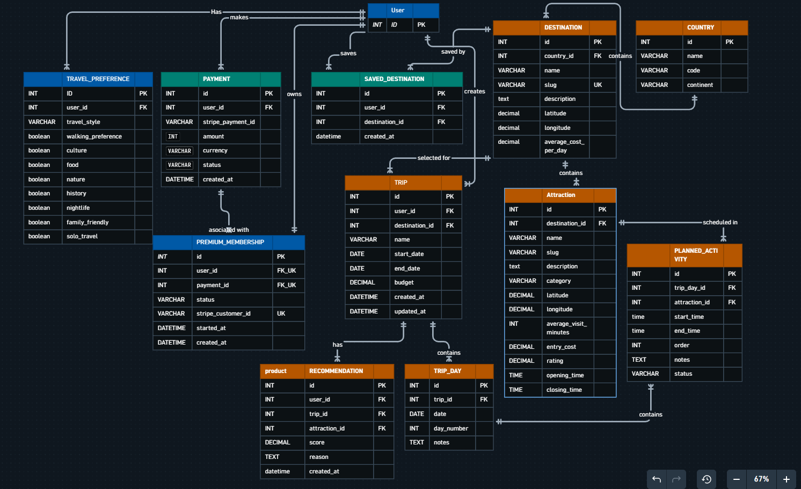

[back to top](#plot-my-path)
#### Database Architecture
---
[back to top](#plot-my-path)
#### Wireframes 
---
Mobile Wireframes 
---
- Landing page
- 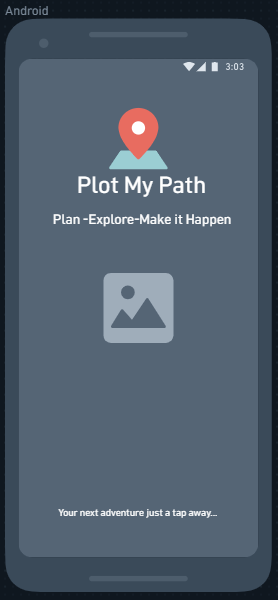 
- Login page
- 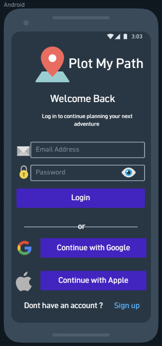
- Register page
- 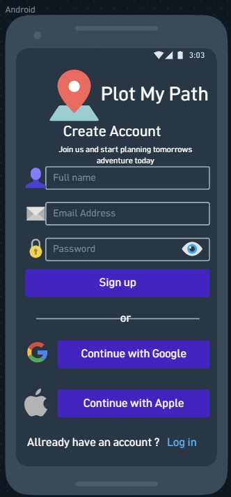
- onboarding pages
- 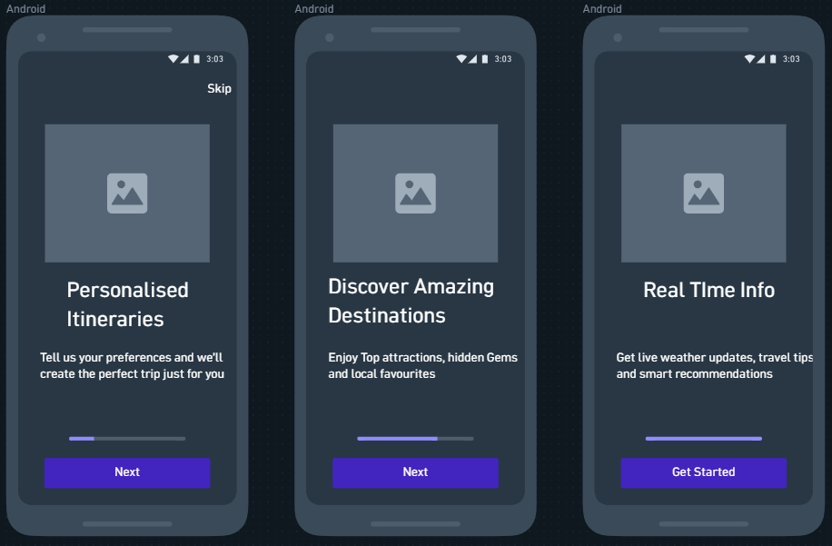
- Home page
- 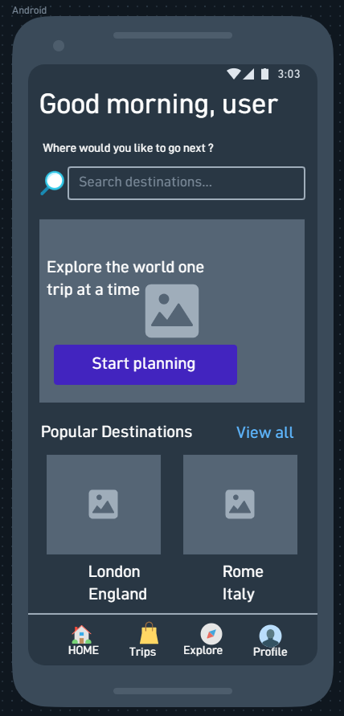
- Explore destination page
- 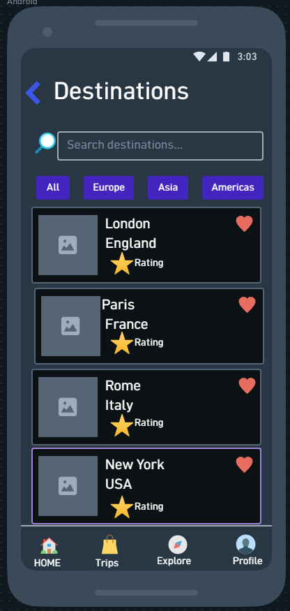
- Destination detail page
- 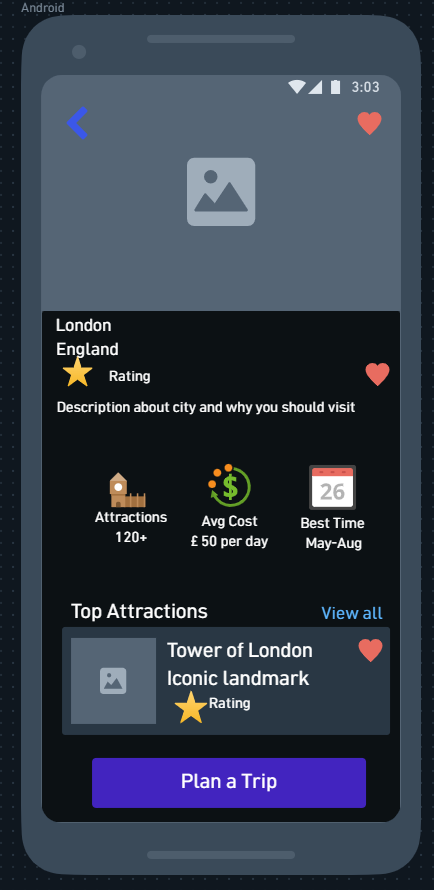
- Create plan page
- 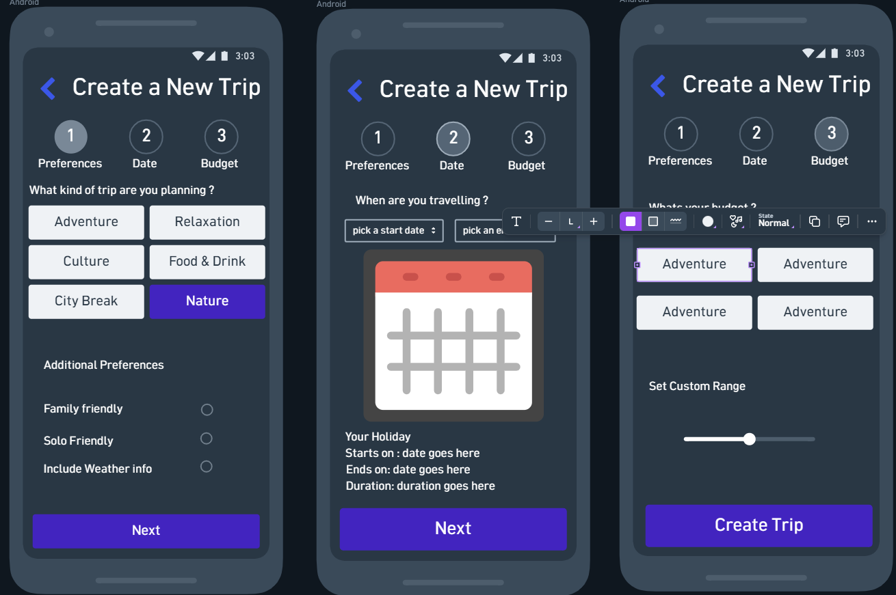
- Trip summary page
- 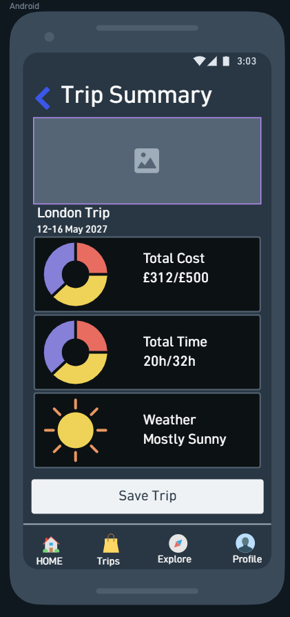
- Profile page
- 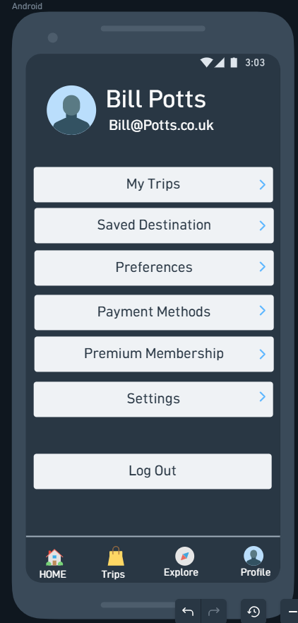

Tablet Wireframes
--- 
- Note: For landing page, login/register and onboarding pages please see mobile wireframes as the view on tablet will be identical but on a larger scale. 
- Homepage
- ![]
Desktop Wireframes
--- 
- Note:For landing page, login/register and onboarding pages please see mobile wireframes as the view on desktop will be identical but on a larger scale.  
[back to top](#plot-my-path)
 
[back to top](#plot-my-path)
### Features
---
Plot My Paths features will include:

                    

#### Existing features
---
[back to top](#plot-my-path)
#### User Goals mapping
---
[back to top](#plot-my-path)
#### Features left to implement
---
[back to top](#plot-my-path)
#### User Goals still to implement
---
[back to top](#plot-my-path)
### Technologies used
---
[back to top](#plot-my-path)
### Testing
---

#### Lighthouse tests 
---
[back to top](#plot-my-path)
#### HTML tests 
---
[back to top](#plot-my-path)
#### CSS tests 
---
[back to top](#plot-my-path)
#### Python code validation
---
[back to top](#plot-my-path)
#### JSX Testing
---
[back to top](#plot-my-path)
#### API Testing 
---
[back to top](#plot-my-path)
#### Security 
---
[back to top](#plot-my-path)
#### Automated Testing
---

[back to top](#plot-my-path)
#### Contrast tests 
---
[back to top](#plot-my-path)
#### Keyboard Accessibility tests 
---
[back to top](#plot-my-path)
#### Manual Features and Usability Testing Log
---
[back to top](#plot-my-path)
#### Development bugs and fixes
---
[back to top](#plot-my-path)
#### Cross browser testing
---
[back to top](#plot-my-path)
#### User Testing 
---
[back to top](#plot-my-path)
### Deployment
---
[back to top](#plot-my-path)
#### How to run this project 
---
[back to top](#plot-my-path)
### Credits
---

[back to top](#plot-my-path)
#### Content/Media/Code/Acknowledgements 
---
[back to top](#plot-my-path)
#### dependencies 
---
[back to top](#plot-my-path)

