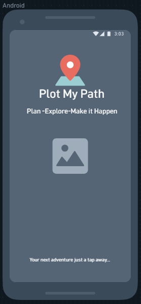
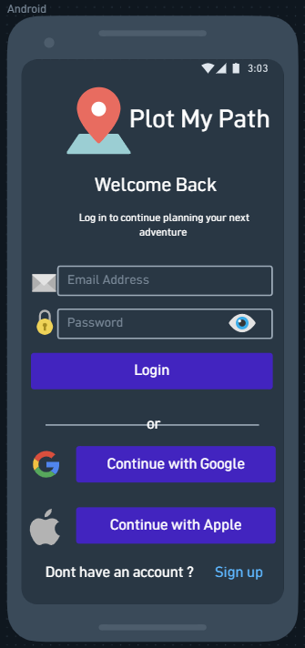
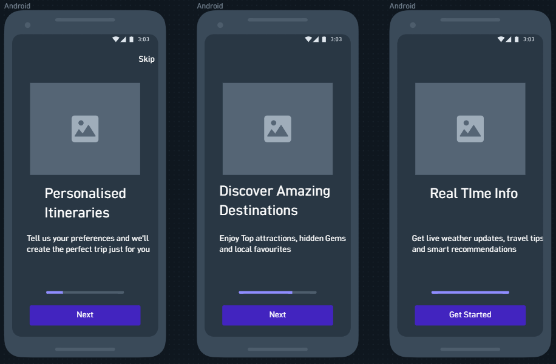
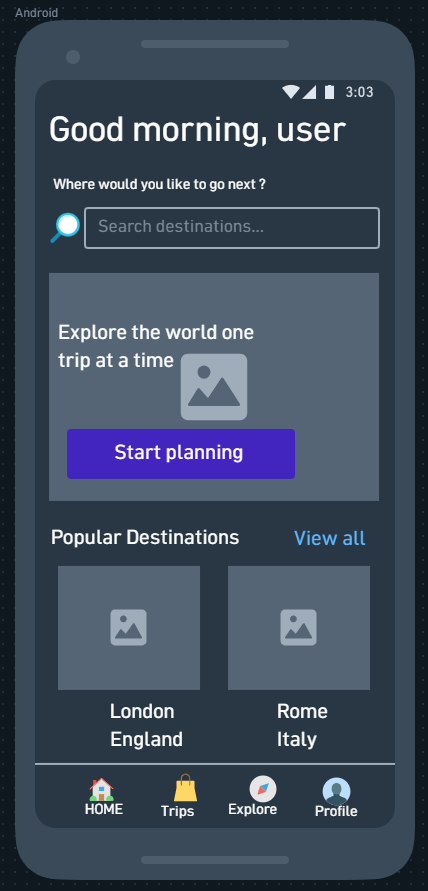
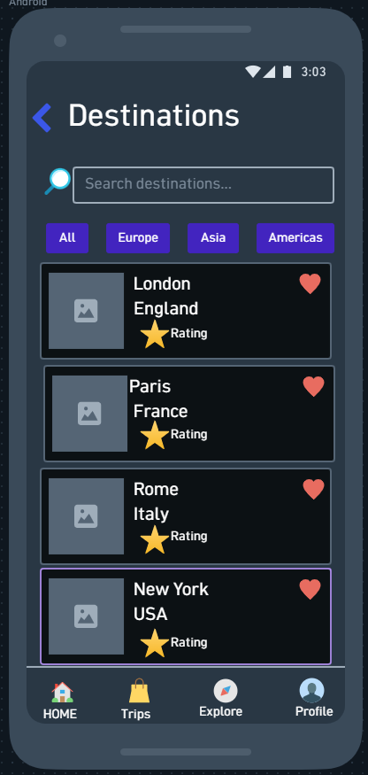
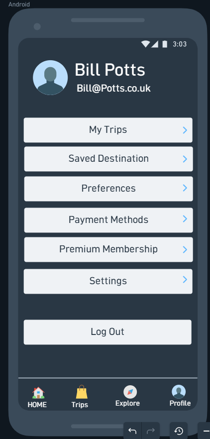

# Plot My Path
---

[To view site]
[To view backend]
 
## Table of Contents

## [UX](#ux-1)

- [Primary Goals](#primary-goals) 
- [Business Goals](#business-goals)
- [User Goals](#user-goals) 
- [User Stories](#user-stories)
- [Design Choices](#design-choices) 
- [ERD Diagram](#erd-diagram) 
- [Database Architecture](#database-architecture)
- [Wireframes](#wireframes) 

## [Features](#features-1)

- [Existing features](#existing-features) 
- [User Goals mapping](#user-goals-mapping) 
- [Features left to implement](#features-left-to-implement) 
- [User Goals still to implement](#user-goals-still-to-implement) 

## [Technologies used](#technologies-used-1)

## [Testing](#testing-1)

- [Lighthouse tests](#lighthouse-tests) 
- [HTML tests](#html-tests) 
- [CSS tests](#css-tests) 
- [Python code validation](#python-code-validation)
- [JSX Testing](#jsx-testing)
- [API Testing](#api-testing) 
- [Security](#security) 
- [Automated Testing](#automated-testing) 
- [Contrast tests](#contrast-tests) 
- [Keyboard Accessibility tests](#keyboard-accessibility-tests) 
- [Manual Features and Usability Testing Log](#manual-features-and-usability-testing-log) 
- [Development bugs and fixes](#development-bugs-and-fixes) 
- [Cross browser testing](#cross-browser-testing) 
- [User Testing](#user-testing) 

## [Deployment](#deployment-1) 

- [How to run this project](#how-to-run-this-project) 

## [Credits](#credits-1) 

- [Content/Media/Code/Acknowledgements](#contentmediacodeacknowledgements) 
- [dependencies](#dependencies) 

### UX
---
#### Primary Goals
---

The primary goals of Plot My Path are:

- To simplify planning a trip by taking users from a destination idea to a day-by-day itinerary in one guided flow.
- To provide a wide selection of destinations and attractions that users can browse and search.
- To personalise trips around each user's travel style and interests.
- To bring practical information such as costs, opening times and weather together in one place.
- To get users trying destinations and attractions they may not have considered before.

[Back to top](#plot-my-path) 
#### Business Goals
---

The business goals of Plot My Path are:

- To let users experience the app with a free first trip before they are asked to pay.
- To convert free users into premium members through a one-off £5 payment that unlocks unlimited trips.
- To build trust by handling payments securely through Stripe and offering a fair refund policy (within 14 days and no more than 3 trips created since purchase).
- To keep accounts genuine by requiring email verification before a user can sign in.
- To keep running costs low by serving images from Cloudinary and using a third-party service for weather data.
- To give users an easy way to get help through a contact form.
- Long term business goals include recommending attractions to users based on their saved travel preferences.

[back to top](#plot-my-path)
#### User Goals
---

The goals for users would be:

- Save time researching and organising a trip by having everything in one place.
- Plan realistic days using attraction opening times, visit lengths and the weather forecast.
- Find inspiration from new destinations and attractions.
- Keep a shortlist of favourite destinations to come back to.
- Pay once rather than commit to a subscription, with the option of a refund if premium isn't right for them.
- Know that their trips and personal details are private.

[back to top](#plot-my-path)
#### User Stories
---

Acceptance criteria are listed beneath each user story.

**Accounts and onboarding**

- As a new visitor, I can create an account with my name, email and password so that I can save and manage my own trips.
  - First name and last name are required.
  - After signing up I am told to check my inbox to verify my email.
  - I cannot sign in until my email address has been verified.

- As a visitor, I can view a landing page and an onboarding carousel so that I understand what the app does before I sign up.
  - Both pages can be viewed without signing in.

- As a signed-in user, I can see a personalised homepage so that I feel welcomed and get ideas straight away.
  - The greeting changes between morning, afternoon and evening.
  - A selection of featured destinations is shown.

- As a signed-in user, I can view my profile page so that I can see my account and membership in one place.
  - Messages about my membership and refunds appear here.

**Discovering destinations**

- As a signed-in user, I can browse destinations by continent so that I can narrow down where I want to go.
  - All destinations are shown by default.
  - Choosing a continent filters the list.

- As a signed-in user, I can search destinations by name so that I can find a place quickly.
  - Partial matches are returned, up to a maximum of 10.
  - An empty search returns no results.

- As a signed-in user, I can view a destination's details so that I can decide whether it suits me.
  - The page shows the description, average cost per day, image and attractions.
  - It shows whether I have already saved the destination.

- As a signed-in user, I can see an attraction's category, visit length, entry cost, rating and opening times so that I can plan realistic days.

- As a signed-in user, I can save and unsave destinations so that I can build a shortlist for later.
  - The same destination cannot be saved twice.
  - The heart/favourite state updates without reloading the page.

- As a signed-in user, I can view my saved destinations so that I can quickly return to the places I liked.
  - Only my own saved destinations are shown.

**Creating a trip**

- As a signed-in user, I can create a trip through a step-by-step form so that setting up a trip feels simple.
  - The steps are preferences, destination and name, dates and budget, and a final review.
  - When I finish I am taken straight to my itinerary.

- As a signed-in user, I can set my travel style and interests so that my trips reflect what I enjoy.
  - My preferences are saved to my profile and loaded into the itinerary builder.

- As a signed-in user, I can only enter sensible dates so that I don't create an impossible trip.
  - The start date cannot be in the past.
  - The end date cannot be before the start date.
  - A trip must be at least one day long.

- As a free user, I am told when I have used my free trip so that I understand how to create more.
  - After one trip I am redirected to my profile with a message about upgrading.
  - The limit is checked again when the form is submitted.
  - Premium members and staff are not limited.

- As a signed-in user, I can view all of my trips so that I can pick up where I left off.
  - Trips are listed with the most recent start date first.
  - Only my own trips are shown.

- As a signed-in user, I can delete a trip so that I can remove plans I no longer need.
  - Only my own trips can be deleted.
  - A confirmation message is shown.

**Building an itinerary**

- As a signed-in user, I can see a day for every date of my trip so that I can plan one day at a time.
  - Days are numbered from 1 and created automatically.
  - Reopening the itinerary never creates duplicate days.

- As a signed-in user, I can add an attraction to a day with a start and end time so that I can build a realistic plan.
  - The attraction must belong to the trip's destination.
  - The start time must be before the end time.
  - Invalid or missing information returns a clear error.

- As a signed-in user, I can remove an activity from a day so that I can change my plans.
  - The remaining activities are renumbered with no gaps.

- As a signed-in user, I can see the weather forecast for my trip dates so that I can plan around it.
  - Daily temperatures, conditions and chance of rain are shown.
  - If the weather service is unavailable, a message is shown and the itinerary still loads.

- As a signed-in user, I can be confident that other people cannot see or change my trips so that my plans stay private.
  - Requesting another user's trip returns "not found".

**Premium membership and payments**

- As a free user, I can pay a one-off £5 to become a premium member so that I can create unlimited trips.
  - Payment is taken through Stripe Checkout.
  - If I am already a premium member I am redirected and cannot pay twice.

- As a user who has paid, I can have my membership activated reliably so that I get what I paid for.
  - The success page checks that the payment belongs to me and has been completed.
  - A Stripe webhook also activates the membership as a backup.
  - Duplicate callbacks do not create duplicate payments.

- As a user whose payment fails, I can see a clear message so that I know what happened and can try again.

- As a premium member, I can request a refund so that I am protected if premium isn't right for me.
  - Refunds are available within 14 days of purchase and when no more than 3 trips have been created since.
  - Premium access is removed and the payment is marked as refunded.
  - Refunds made from the Stripe dashboard also remove premium access.

**Recommendations and support**

- As a signed-in user, I can receive recommended attractions for my trip based on my preferences so that I can discover things I'd enjoy. *(planned feature)*
  - Each recommendation has a score and a short reason.
  - The highest scoring recommendations are shown first.

- As a visitor or signed-in user, I can contact the team through a form so that I can get help.
  - Name, email, subject and message are required.
  - If I am signed in, my name and email are filled in for me.
  - The team receives my message by email and can reply directly to me.

[back to top](#plot-my-path)
#### Design Choices
---

Plot My Path is a mobile-first travel planning app. Its interface helps users discover destinations, create trips, organise activities and make decisions while travelling.

The design uses a clean, modern style with rounded cards, generous spacing, clear typography, imagery and a purple and blue colour scheme. These choices make the app feel approachable and easy to navigate, while keeping travel information the main focus.

The layout adapts progressively to larger screens rather than creating separate mobile, tablet and desktop experiences. On small screens, information is prioritised and shown one step at a time. On larger screens, related information can appear side by side, making better use of the space.

This suits a travel app because people use it in different contexts: planning at home on a desktop, researching destinations on a tablet, or checking an itinerary on a phone while travelling.

[back to top](#plot-my-path)
#### ERD Diagram
---

 ERD Data flow  

 | Model       	| Relationship      	| Model               	|
|-------------	|-------------------	|---------------------	|
| User        	| has               	| Travel_Preference   	|
| User        	| Saves             	| Saved_Destination   	|
| User        	| creates           	| Trip                	|
| User        	| makes             	| Payment             	|
| User        	| holds             	| Prermium_Membership 	|
| User        	| recieves          	| Recommendation      	|
| Payment     	| activates         	| Premium_Membership  	|
|             	|                   	|                     	|
| Country     	| contains          	| Destination         	|
| Destination 	| has               	| Attraction          	|
| Destination 	| saved as          	| Saved_Destination   	|
| Destination 	| is visited in     	| Trip                	|
|             	|                   	|                     	|
| Trip        	| is split into     	| Trip_Day            	|
| Trip        	| generates         	| Recommendation      	|
| Trip Day    	| schedules         	| Planned_activity    	|
| Attraction  	| is scheduled as   	| Planned_Activity    	|
| Attraction  	| is recommended in 	| Recommendation      	|

 ERD Diagram  

[back to top](#plot-my-path)
#### Database Architecture
---

 Database Architecture 

The backend application uses a relational database structure built with Django. Below is a description of the database entities shown in the ERD diagram above. The User model is provided by Django and django-allauth, so it is not described here.

###### TravelPreference Model

- user: A ForeignKey linking the preferences to the user's account, using models.CASCADE so they are removed if the user is deleted.
- travel_style: A CharField with a 50-character limit, restricted to a set of choices (adventure, relaxation, city break, culture, food & drink and nature).
- walking_preference, culture, food, nature, history, nightlife, family_friendly, solo_travel: BooleanFields that record the user's interests, each defaulting to False.

###### SavedDestination Model

- user: A ForeignKey linking the saved item to a user, with the related name saved_destinations and cascading deletes.
- destination: A ForeignKey linking the saved item to a Destination, with the related name saved_by_users and cascading deletes.
- created_at: A DateTimeField that records when the destination was saved, set automatically.
- Meta: A unique_together constraint on user and destination to stop the same destination being saved twice.

###### Country Model

- name: A CharField with a 100-character limit that stores the country name and is used as the natural key when loading fixtures.
- code: A CharField with a 3-character limit that stores the ISO country code.
- continent: A CharField with a 50-character limit that is used to filter destinations.

###### Destination Model

- country: A ForeignKey to the Country model with the related name destinations and cascading deletes.
- name: A CharField with a 100-character limit.
- slug: A unique SlugField used as the natural key for fixtures and to build the Cloudinary image address.
- description: A TextField holding the destination description.
- latitude and longitude: DecimalFields (9 digits, 6 decimal places) used for weather lookups.
- average_cost_per_day: A DecimalField (10 digits, 2 decimal places) storing the estimated daily cost.
- get_image_url: A property that builds the Cloudinary image address from the slug so images do not need to be stored in the database.

###### Attraction Model

- destination: A ForeignKey to the Destination model with the related name attractions and cascading deletes.
- name, slug, description: Fields storing the attraction name, its slug and a full description.
- category: A CharField with a 50-character limit.
- latitude and longitude: DecimalFields (9 digits, 6 decimal places) storing the attraction's location.
- average_visit_minutes: An IntegerField storing how long a visit usually takes.
- entry_cost: A DecimalField (10 digits, 2 decimal places) storing the entry price.
- rating: An optional DecimalField (3 digits, 2 decimal places) which can be left blank or null.
- opening_time and closing_time: TimeFields storing when the attraction is open.
- Meta: A unique_together constraint on destination and slug.
- get_image_url: A property that builds the Cloudinary image address from the slug.

###### Trip Model

- user: A ForeignKey to the user who owns the trip, with the related name trips and cascading deletes.
- destination: A ForeignKey to the Destination model with the related name trips and cascading deletes.
- name: A CharField with a 150-character limit.
- start_date and end_date: DateFields storing the trip dates.
- budget: A DecimalField (10 digits, 2 decimal places) storing the user's budget.
- created_at and updated_at: DateTimeFields set automatically when the trip is created and updated.

###### TripDay Model

- trip: A ForeignKey to the Trip model with the related name trip_days and cascading deletes.
- date: A DateField storing the calendar date of the day.
- day_number: An IntegerField storing the day's position within the trip.
- notes: An optional TextField for the user's notes.

###### PlannedActivity Model

- trip_day: A ForeignKey to the TripDay model with the related name planned_activities and cascading deletes.
- attraction: A ForeignKey to the Attraction model with the related name planned_activities and cascading deletes.
- start_time and end_time: TimeFields storing when the activity takes place.
- order: An IntegerField that sets the position of the activity within the day.
- notes: An optional TextField for the user's notes.
- status: A CharField with a 50-character limit, defaulting to "scheduled".
- Meta: Orders activities by the order field.

###### Recommendation Model

- user: A ForeignKey to the user receiving the recommendation, with the related name recommendations and cascading deletes.
- trip: A ForeignKey to the Trip model with the related name recommendations and cascading deletes.
- attraction: A ForeignKey to the Attraction model with the related name recommendations and cascading deletes.
- score: A DecimalField (5 digits, 2 decimal places) showing how well the attraction matches the user's preferences.
- reason: A TextField limited to 200 characters explaining why the attraction was recommended.
- created_at: A DateTimeField set automatically when the recommendation is created.
- Meta: Orders recommendations from the highest score to the lowest.

###### Payment Model

- user: A ForeignKey to the user who paid, with the related name payments and cascading deletes.
- stripe_payment_id: An optional, unique CharField (255 characters) storing the Stripe payment ID, which also stops the same payment being recorded twice.
- amount: A PositiveIntegerField storing the amount in pence.
- currency: A CharField with a 3-character limit, defaulting to "gbp".
- status: A CharField restricted to pending, succeeded, failed or refunded, defaulting to pending.
- created_at: A DateTimeField set automatically when the payment is recorded.
- amount_pounds: A property that converts the stored pence amount into pounds.

###### PremiumMembership Model

- user: A OneToOneField to the user with the related name membership, so each user can only have one membership.
- payment: An optional OneToOneField to the Payment model that uses models.SET_NULL so the membership remains if the payment record is removed.
- status: A CharField restricted to active, inactive, cancelled, expired or past due, defaulting to inactive.
- stripe_customer_id: An optional, unique CharField (255 characters) storing the Stripe customer ID.
- started_at: An optional DateTimeField recording when premium access began, which is used to work out refund eligibility.
- created_at: A DateTimeField set automatically when the membership record is created.
- is_active: A property that returns True when the status is active.

[back to top](#plot-my-path)
#### Wireframes 
---
Mobile Wireframes 
---
- Landing page
-  
- Login page
- 
- Register page
- 
- onboarding pages
- 
- Home page
- 
- Explore destination page
- 
- Destination detail page
- 
- Create plan page
- 
- Profile page
- 

Tablet Wireframes
--- 
- Note: For landing page, login/register and onboarding pages please see mobile wireframes as the view on tablet will be identical but on a larger scale. 
- Homepage
- ![]
Desktop Wireframes
--- 
- Note:For landing page, login/register and onboarding pages please see mobile wireframes as the view on desktop will be identical but on a larger scale.  
[back to top](#plot-my-path)
 
[back to top](#plot-my-path)
### Features
---
Plot My Paths features will include:

         
#### Existing features
---

#### Features

##### Trip planning
- **Guided trip creation:** a four-step wizard collects your travel preferences, destination and trip name, dates and budget, then a review step before the trip is created.
- **Travel preferences:** choose a travel style and interests such as culture, food, nature, history, nightlife, family-friendly and solo travel. Your preferences are saved to your profile.
- **Itinerary builder:** every trip gets a day-by-day itinerary generated automatically from its start and end dates.
- **Plan activities:** add attractions from your destination to any day with start and end times, and remove them again. Activities are numbered in order, and the numbering closes up when one is deleted.
- **Weather forecast:** daily forecasts (temperatures, conditions and chance of rain) are shown for your trip dates, powered by Visual Crossing. If the forecast is unavailable, the itinerary still loads.
- **My trips:** view and delete your own trips.

##### Destinations
- **Browse destinations and attractions:** explore destinations, each with its own set of attractions (category, entry cost, typical visit length and opening times).
- **Favourites:** save destinations with a one-click favourite button, without reloading the page.
- **Search:** a live search bar for finding destinations.

##### Accounts and membership
- **Sign up and log in:** email-based accounts, plus sign in with Google.
- **Onboarding:** a short onboarding flow for new users.
- **Free and premium plans:** free accounts can create one trip, and premium members can create as many as they like. Premium upgrades are handled through Stripe Checkout.
- **Profile page** for managing your account and membership.

##### Design and experience
- **Responsive layout:** a bottom navigation bar on mobile that moves to the top on larger screens.
- **Light and dark themes:** a theme toggle (Fantasy and Sunset) that remembers your choice and falls back to your system preference.
- **Flash messages** that fade out automatically.
- **Custom 404 page.**

##### Built with
Django, django-allauth, React, Vite (via django-vite), Tailwind CSS with daisyUI, Cloudinary for images, Stripe for payments, Brevo for email, and WhiteNoise for static files.

[back to top](#plot-my-path)
#### User Goals mapping
---
[back to top](#plot-my-path)
#### Features left to implement
---
[back to top](#plot-my-path)
#### User Goals still to implement
---
[back to top](#plot-my-path)
### Technologies used
---
[back to top](#plot-my-path)
### Testing
---
#### Lighthouse tests 
---
[back to top](#plot-my-path)
#### HTML tests 
---
[back to top](#plot-my-path)
#### CSS tests 
---
[back to top](#plot-my-path)
#### Python code validation
---

All code has been formatted to PEP8 style standards using black and the command 
black . and then checked to confirm as is shown below

black --check .
All done! ✨ 🍰 ✨
54 files would be left unchanged.
(.venv) 

[back to top](#plot-my-path)

#### JSX Testing
---

[back to top](#plot-my-path)

#### API Testing 
---
[back to top](#plot-my-path)

#### Security 
---
[back to top](#plot-my-path)
#### Automated Testing
---

#### Django Testing – Using Django's Testing Suite

---
- All django testing was carried out using the command python manage.py test "appname" --keepdb
- All sections have their corrosponding commit number for when they were originaly carried out underneath each section header 
##### Core Testing – The Tests

- Core tests ran at commit **173448e**.

**Pages**

- The landing page and onboarding page load for anyone and use their expected templates.
- The homepage requires login: a logged-out visitor is redirected to the login page.
- The homepage greeting depends on the time of day: "Good morning" at 9am, "Good afternoon" at 2pm and "Good evening" at 8pm. The clock is mocked, so the tests give the same result whenever they run.

**Contact page**

- The page loads and uses the correct contact template.
- For a logged-in user, the form is pre-filled with their first name and email address.
- A valid submission sends one email containing the message and redirects back to the contact page. Django's in-memory test mailbox is used.
- An invalid submission re-renders the form and sends no email.

**Signup form**

- The form is valid with a first and last name, and invalid when either is missing.
- Calling signup saves the first and last name onto the user.

**Contact form**

- The form is valid with a name, email, subject and message.
- The form is invalid when any required field is missing.
- A malformed email address is rejected.

##### Core Testing – Results

System check identified no issues (0 silenced).
.........................................
----------------------------------------------------------------------
Ran 41 tests in 33.193s

OK
Preserving test database for alias 'default'...

---

##### Accounts Model Testing – The Tests

- Accounts model tests ran at commit **df124fc**.

**Travel Preference**

- A new preference defaults every interest flag (e.g. walking and culture) to False, and its string representation is "Preferences for <username>".
- A travel style outside the allowed choices is rejected by validation.
- Deleting a user deletes their travel preferences.

**Saved Destination**

- Its string representation reads "<username> saved <destination>", and a creation timestamp is set automatically.
- A user cannot save the same destination twice.
- Different users can save the same destination.
- Deleting a destination removes saved records pointing to it.
- Deleting a user removes all their saved destination records.

##### Accounts View Testing – The Tests
- Account view tests carried out at **commit 7e57d3c**

Accounts view tests cover authentication, profile information, saved destinations and favourite functionality.

All views are tested to confirm they require login and redirect logged-out users to the login page.

**Profile page**

- A signed-in user receives the correct profile template and sees their username.

**Favourite destinations**

- A user sees only their own saved destinations and cannot see another user's saved destinations.

**Toggle favourite**

- The first POST request saves the destination and returns `{"is_favourite": true}`.
- A second POST request removes the saved destination and returns `{"is_favourite": false}`.
- GET requests are rejected.
- An unknown destination returns a 404 response.
- Toggling one user's favourite does not affect another user's saved destinations.

##### Accounts Testing – Results

System check identified no issues (0 silenced).
................
----------------------------------------------------------------------
Ran 16 tests in 16.829s

OK
Preserving test database for alias 'default'...

---

##### Destinations Model Testing – The Tests

- Destinations model tests ran at commit **72fe012**.

**Country**

- Its string representation is the country name.
- The natural key is the name, and looking a country up by natural key returns the correct record.
- Looking up an unknown country by natural key raises `DoesNotExist`.

**Destination**

- Its string representation is the destination name.
- The natural key is the slug, and lookup by natural key works.
- Slugs must be unique, enforced by a database constraint.
- The image URL is built from the Cloudinary cloud name and the destination slug. This only builds a string, so no request is made to Cloudinary.
- Destinations are accessible through their country, and deleting a country deletes its destinations.

**Attraction**

- Its string representation is the attraction name, and the rating is optional.
- The same slug cannot be used twice within one destination, but can be reused in a different destination.
- The image URL is built from the Cloudinary cloud name and attraction slug.
- Attractions are accessible through their destination, and deleting a destination deletes its attractions.

##### Destinations View Testing – The Tests

- Destination view tests ran at commit **3482b9a15**.

All four views require login: logged-out visitors are redirected to the login page.

**Destination list**

- By default, every destination is shown and the selected continent is "all".
- Filtering by continent returns only matching destinations.
- Continent filtering ignores letter case.
- An unknown continent returns an empty list rather than an error.
- The continent dropdown values are distinct and sorted alphabetically.

**Destination detail**

- The correct destination and template are used, and an unknown destination ID returns a 404.
- Only that destination's attractions are listed.
- The "is favourite" flag is false by default.
- The flag becomes true once the current user has saved the destination.
- Another user's saved destination does not affect the current user's favourite status.

**Search (JSON)**

- A missing or blank query returns an empty result list.
- Matching is partial and case-insensitive.
- A query with no matches returns an empty list.
- Each result contains the destination ID, name, slug, description, cost (as a string) and image URL.
- Results are capped at 10.

**Popular destinations (JSON)**

- Returns an empty list when there are no destinations.
- Returns all destinations when there are fewer than three.
- Returns at most three destinations when more are available.
- The selection is random, so the tests check the number of results rather than which destinations are returned.
- This view does not currently have a URL, so the tests call it directly using Django's RequestFactory.

##### Destinations Testing – Results

System check identified no issues (0 silenced).
..........................................
----------------------------------------------------------------------
Ran 42 tests in 15.698s

OK
Preserving test database for alias 'default'...

---

##### Payments Model Testing – The Tests

- Payments model tests ran at commit **72fe012**.

**Payment model**

- Its string representation contains the username, amount and currency.
- A new payment defaults to GBP and a pending status.
- amount_pounds converts the stored pence amount into pounds (1999 becomes 19.99).
- The created_at timestamp is set automatically.
- The Stripe payment ID must be unique, enforced by a database constraint.
- A negative payment amount fails validation.
- Payments are accessible through their associated user.

**PremiumMembership model**

- Its string representation contains the username and membership status.
- A new membership defaults to inactive.
- is_active returns true for an active membership and false for an inactive one.
- The created_at timestamp is set automatically.
- A membership is accessible through both its associated user and payment.

##### Payment Views Testing – The Tests

- Payment view testing carried out from **commit 2a9e879 to commit 9708d8c**

**Checkout**

- The checkout page loads for a logged-in user.
- Logged-out users are redirected away from checkout.
- Users who already have an active membership are redirected away from checkout.
- Creating a checkout session returns the Stripe checkout URL as JSON.
- Users who already have an active membership cannot create a new checkout session (409 response), and Stripe is not called.
- The create checkout session view only accepts POST requests.

**Payment success**

- A request with no session ID returns an error (400).
- A paid session creates a payment record and an active membership.
- A session belonging to a different user is rejected (403), and nothing is saved.
- An unpaid session is rejected (400), and nothing is saved.
- Loading the success page twice for the same session does not create duplicate payments or memberships.

**Payment failed**

- The payment failed page loads successfully.
- An error message passed in the URL is displayed on the page.

**Stripe webhook**

- A paid checkout.session.completed event creates a payment and an active membership.
- An unpaid checkout.session.completed event is accepted but creates no payment.
- An invalid payload or signature returns an error (400).
- A charge.refunded event marks the payment as refunded and sets the membership to inactive.
- The webhook only accepts POST requests.

**Refunds**

- A refund is allowed within 14 days of the membership start date.
- A refund is not allowed if the membership has no start date or started more than 14 days ago.
- The refund view only accepts POST requests.
- Logged-out users are redirected away from the refund view.
- A successful refund calls Stripe once, marks the payment as refunded and sets the membership to inactive.
- No refund is processed for a membership older than 14 days or for a membership that is not active. In both cases, the user is redirected.

##### Payments Testing – Results

Found 39 test(s).
Using existing test database for alias 'default'...
System check identified no issues (0 silenced).
.......................................
----------------------------------------------------------------------
Ran 39 tests in 66.204s

OK
Preserving test database for alias 'default'...

---

##### Trips Model Testing – The Tests

---

Trips model testing covers the Trip, TripDay, PlannedActivity and Recommendation models.

**Trip, TripDay and PlannedActivity models**

- The string form of a trip is its name, a day is "Day N - trip name", and an activity is the attraction name followed by its start time.
- A new activity defaults to a scheduled status.
- The trip's absolute URL returns the correct itinerary builder URL.
- A budget that is too large fails validation.
- Deleting a user deletes their trips.
- Deleting a trip deletes its days and planned activities.

**Recommendation model**

- A recommendation can be created with the correct score, reason, user, trip and attraction.
- The string representation includes the username, attraction name and recommendation score.
- Recommendations are ordered by score, with the highest-scoring recommendation first.
- Deleting a user deletes their recommendations.
- Deleting a trip deletes its recommendations.
- Deleting an attraction deletes its recommendations.

##### Trips View Testing – The Tests

-- All trip views and forms testing carried out from **commit efca79f to commit 994e04**
 

**My trips**

- Logged-out users are redirected to the login page.
- Users only see their own trips, never another user's.

**Delete trip**

- A POST request deletes the trip and redirects to the my trips page.
- A user cannot delete another user's trip (404), and the trip is kept.

**Itinerary builder**

- Logged-out users are redirected to the login page.
- Another user's trip returns a 404.
- The page renders the correct template and passes the trip in the context.
- A day is generated for every date of the trip (a five-day trip gives five days) and saved to the database.

**Weather**

- The weather API response is mapped to the fields the site uses (date, maximum and minimum temperature, conditions, chance of rain and icon), and any unrelated fields are dropped.
- The API call is mocked to prevent an actual external request.

**Add activity**

- Logged-out users are redirected to the login page and nothing is saved.
- Another user's trip returns a 404 and nothing is saved.
- Each required field (attraction, start time and end time) is checked in turn, and leaving any one out returns an error (400).
- A valid request creates the activity (201), returns its details as JSON and saves it with the correct order and a scheduled status.
- The response includes the attraction ID, start and end times, order, status and notes.

**Delete activity**

- Deleting an activity removes it from the database and returns a success response (200) with a confirmation message.
- Another user's activity returns a 404 and the activity is kept.

**Wizard forms**

- The preferences form is valid with just a travel style, and optional preference checkboxes default to false.
- Travel style is required.
- The destination form is valid with a destination and trip name, and both fields are required.
- The trip details form accepts a future start date, end date and budget.
- A start date in the past is rejected with an error message.
- The review form is valid when empty.

##### Trips Permissions Testing – The Tests
- Permission tests carried out at **commit 94e3ae2
as well as some missing view tests** 
**Premium membership**

- A user without a membership is not considered premium.
- A user with an active premium membership is recognised as a premium user.

**Trip creation limits**

- A free user can create only one trip. Once a trip exists, they cannot create another.
- A premium user can create multiple trips.

##### Trip Creation Wizard Testing – The Tests

**Create trip**

- Logged-out users are redirected to the login page.
- A free user who already has a trip is redirected to their profile with a message explaining the free trip limit.
- The wizard steps advance in order: preferences, destination, details, then review.
- Completing the wizard creates the trip with the correct name, destination and budget, saves the user's travel preferences, and redirects to the itinerary builder for the new trip.

##### Trips Testing – Results

System check identified no issues (0 silenced).
.........................................
----------------------------------------------------------------------
Ran 41 tests in 33.193s

OK
Preserving test database for alias 'default'...

---

[back to top](#plot-my-path)

#### Contrast tests 
---
[back to top](#plot-my-path)
#### Keyboard Accessibility tests 
---
[back to top](#plot-my-path)
#### Manual Features and Usability Testing Log
---
[back to top](#plot-my-path)
#### Development bugs and fixes
---
[back to top](#plot-my-path)
#### Cross browser testing
---
[back to top](#plot-my-path)
#### User Testing 
---
[back to top](#plot-my-path)
### Deployment
---
[back to top](#plot-my-path)
#### How to run this project 
---
[back to top](#plot-my-path)
### Credits
---

[back to top](#plot-my-path)
#### Content/Media/Code/Acknowledgements 
---
[back to top](#plot-my-path)
#### dependencies 
---
[back to top](#plot-my-path)

